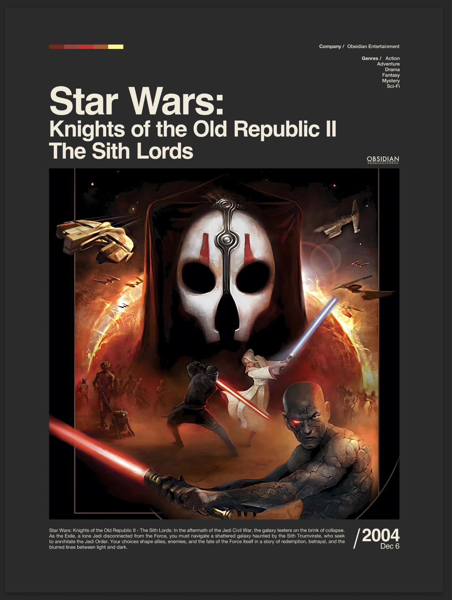

<div align="center">

# MyWallpapers

### Your favorites. Ready for the wall.

Posters for games, music albums, movies and TV series, print-ready from A5 to 70 × 100 cm.<br>
Double-click `index.html` and start. No server, no install. Only the search needs the internet.

<br>

[](LICENSE)


<br>



</div>

> [!WARNING]
> **This project is vibe-coded.** Most of it was written in conversation with an AI (Claude Code) instead of by hand. A built-in self-test checks the code, but nobody has reviewed it line by line. Use it at your own risk.

<br>

Contents: [Three posters](#three-posters-one-page) · [Search](#type-a-little-find-a-lot) · [Games](#games-with-the-art-they-deserve) · [Albums](#every-album-every-track) · [Movies & series](#movies-and-series-front-row) · [Pictures](#ten-pictures-pick-one) · [Formats](#any-size-either-way) · [Tech specs](#tech-specs) · [Pictures and data](#whose-pictures-whose-data) · [Developers](#for-developers) · [License](#license)

<br>

## Three posters. One page.

The start page has a tile for each kind of poster: game, album, and movie or series. You can also jump straight in with `index.html#spiel`, `#album` and `#film`. Each page remembers where you left off.

<br>

## Type a little. Find a lot.

Every search runs several ways at once, so it finds brand-new titles and forgives typos. It does a full-text search, a fuzzy one ("the odyssee" finds The Odyssey), a prefix search while you type, and a search by German titles and aliases. The exact match sits at the top, followed by the best-known titles. Announced movies (film projects in Wikidata) count too.

<br>

## Games. With the art they deserve.

The game search uses Wikidata and Wikipedia, no key needed. It fills in the title, developer, genres, release date and description, and loads the logo from Steam or Wikidata.

Pictures come from every source at the same time (see [Ten pictures](#ten-pictures-pick-one)):

| Source | What you get |
|---|---|
| Microsoft Store | Key art, covers and screenshots up to 3840 × 2160 px |
| Steam | Up to 3840 × 1240 px |
| Nintendo eShop | Key art at 1920 × 1080 px, screenshots |
| The game's Fandom wiki | Box art and artwork, often over 1500 px |
| Wikipedia | Cover |

<br>

## Every album. Every track.

Search by album or artist through MusicBrainz and Apple Music (the iTunes search), neither of which needs a key. Click an artist to see their discography. Apple Music adds albums MusicBrainz doesn't have yet, such as very new ones, and supplies the original cover when the Cover Art Archive has none. If MusicBrainz finds nothing, it tries again with a fuzzy search ("rammstien").

The poster gets the album, artist, label, genres, release date and the track list with running times. The cover loads at full size from the Cover Art Archive. The track list sits below the cover in up to three columns, and its font shrinks until even long titles fit.

Spotify isn't used because its API always requires a key.

<br>

## Movies and series. Front row.

Switch between **Film** and **Serie** at the top. The layout is the same as the game poster.

Movies come from Wikidata and Wikipedia, no key needed: director, genres, running time, release date and plot. Well-known movies show up first in the search.

Series come from TVmaze, also without a key: network, genres, seasons, premiere date and plot. Wikidata fills in what TVmaze can't find.

Pictures again come from every source. Apple TV has stills without text up to 4320 × 3240 px, posters, season covers, frames from trailers and the logo as a transparent PNG. TVmaze adds all its stills, posters and banners, and Fandom and Wikipedia fill in the rest.

<br>

## Ten pictures. Pick one.

After you pick a search result, the app asks every picture source, measures what comes back and shows you the ten best with their resolution. No source gets more than four spots, so every source gets a look in. They're ranked by the shorter side, because the picture area is almost square and the shorter side decides the usable resolution.

The best picture loads right away. Click another one to swap it, and **Gefundene Bilder…** (found pictures) opens the selection again.

- Wikidata stores the IDs for Apple TV, Microsoft Store, Steam and Nintendo, along with the Fandom wikis. Series are matched by their TVmaze ID. When the wiki is missing, the app guesses it from the title ("Need for Speed: Most Wanted" becomes needforspeed.fandom.com) and uses the page "Title (Year)".
- Apple TV and Nintendo are queried with the public keys their own websites use, not with account keys. If one of those keys changes, you only lose those pictures.
- If nothing big turns up, the app tells you. It links to the press kit, TMDB, Alpha Coders, Google and Wallhaven, so you can find a picture there, copy it and paste it with **Ctrl+V**. Or let the AI upscale what you have.
- Some services can't be used. TMDB, OMDb, Trakt, fanart.tv, SteamGridDB, IGDB and OpenCritic require a key. IMDb, GOG, PlayStation Store, GameTDB, LaunchBox and speedrun.com block requests from the browser (no CORS). The iTunes search no longer finds movies. Albums still use it, through JSONP, because it only sends CORS headers some of the time.

<br>

## Any size. Either way.

A5 to A1, plus 30 × 40, 40 × 50, 50 × 70, 60 × 90 and 70 × 100 cm. Every format comes in portrait and landscape, with the **Hoch | Quer** switch next to the format.

In landscape the picture fills the full height on the left (for albums, the square cover). The column to its right has the color bar, details and title at the top, and the description or track list above the year at the bottom. The printed text is the same size as in portrait.

Exports run at 300 dpi. The largest formats come out slightly lower, because an export is capped at 50 megapixels. Any more and the browser crashes. Small formats get relatively larger text.

<br>

## Your crop. Your colors.

Drag the picture in the preview to frame it. Zoom with the mouse wheel or the slider, and nudge it with the arrow keys.

The color bar has five swatches, picked from the picture automatically or set by hand. The background is either **Dunkel** (charcoal) or **Hell** (warm paper beige), and the generator's own interface switches along with it.

<br>

## Too small? Not anymore.

**Mit KI hochskalieren** (upscale with AI) runs ESRGAN locally in your browser on WebGL. It scales pictures that are too small up to print resolution, at most 4×. Nothing leaves your computer.

<br>

## Saved. Exported. Printed.

Your input and pictures stay in the browser. **Sichern…** saves a project as a `.poster.json` file, and **Öffnen…** loads it again on the matching page.

Export as PNG or JPG, with an optional 3 mm bleed for the print shop. The file carries its dpi value.

<br>

## Tech specs

| | |
|---|---|
| **Posters** | Games · Albums · Movies · TV series |
| **Formats** | A5 · A4 · A3 · A2 · A1 · 30 × 40 · 40 × 50 · 50 × 70 · 60 × 90 · 70 × 100 cm, portrait and landscape |
| **Export** | PNG or JPG at 300 dpi (max. 50 megapixels), optional 3 mm bleed |
| **Upscaling** | ESRGAN x4 on TensorFlow.js, runs locally on WebGL |
| **Backgrounds** | Dark (charcoal) · Light (paper beige) |
| **Projects** | `.poster.json` |
| **Interface** | German |
| **Runs on** | Any current browser, from a single file, offline except for the search |
| **License** | MIT |

<br>

## Double-click. Done.

Download the repository and open `index.html`. That's all. Everything is in that one file: code, font, AI runtime and model. It even works in sandboxed browsers, such as Brave or Firefox as a Flatpak, which only see the file you opened. That's also why the start page and the game, album and movie pages are sections of one page and not separate files.

<br>

## Whose pictures. Whose data.

The posters are meant for **private use**. Covers, key art and logos are protected by copyright and belong to their owners. If you want to publish or sell a poster, you need their permission.

The services MyWallpapers queries, and the licenses of their data:

| Service | Used for | Data license |
|---|---|---|
| [Wikidata](https://www.wikidata.org) | Game data, logo reference | CC0 |
| [Wikipedia](https://www.wikipedia.org) | Description, placeholder cover | Text CC BY-SA 4.0, images per file |
| [Wikimedia Commons](https://commons.wikimedia.org) | Logos | Per file |
| Steam (steamstatic.com) | Game key art, cover, logo | Publisher's rights |
| Microsoft Store (displaycatalog) | Game key art, cover | Publisher's rights |
| Nintendo eShop (nintendo.com, Algolia) | Game key art | Nintendo's or publisher's rights |
| [Fandom](https://www.fandom.com) | Box art from game wikis | Per file |
| Apple TV (uts-api.itunes.apple.com) | Movie and series stills, posters, logos | Studio's or network's rights |
| [MusicBrainz](https://musicbrainz.org) | Album data, track list | Core data CC0, genres CC BY-NC-SA 3.0 |
| [Cover Art Archive](https://coverartarchive.org) | Album covers | Label's or artist's rights |
| Apple Music (itunes.apple.com) | Album data, track list, fallback cover | Label's or artist's rights |
| [TVmaze](https://www.tvmaze.com) | Series data, stills, fallback posters | Data CC BY-SA 4.0, images studio's or network's rights |

MusicBrainz allows one request per second. The album search sticks to that, so it's a bit slower than the game search.

<br>

## For developers.

`index.html` is **generated**. Edit the files in `src/` (`index.html`, `app.css`, `app.js`), then rebuild:

```
python3 build.py
```

To run the self-test, start `python3 -m http.server` in the repo after building and open `http://localhost:8000/#selftest`. The tab title shows `SELFTEST OK` or the first error. You only need the server because the test loads the sample picture from `Examples/`. The online services are simulated, so the test runs without internet.

<br>

## License.

MyWallpapers' own code is under the [MIT License](LICENSE). The third-party parts that `build.py` embeds keep their own licenses:

| File | Origin | License |
|---|---|---|
| `vendor/tf.min.js` | TensorFlow.js 4.22.0 | Apache 2.0, `vendor/LICENSE-tfjs.txt` |
| `vendor/esrgan-medium-x4.js` | @upscalerjs/esrgan-medium 1.0.0, x4 model | MIT, `vendor/LICENSE-esrgan.txt` |
| `fonts/fonts.css` | TeX Gyre Heros (free Helvetica clone) | GUST Font License, `fonts/GUST-FONT-LICENSE.txt` |
